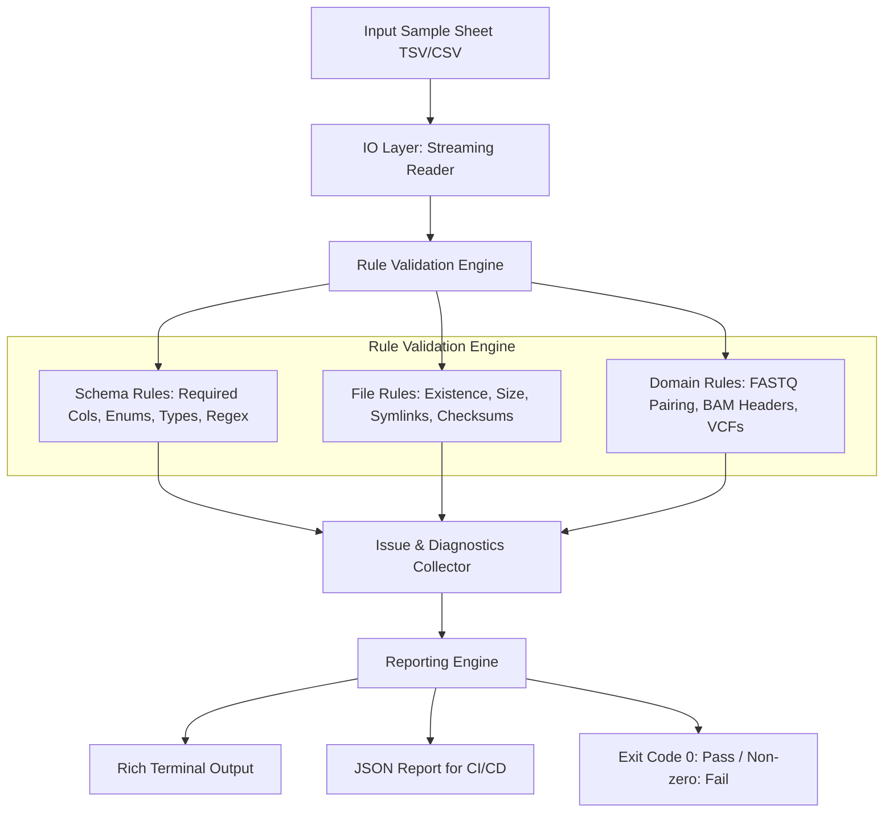

# SampleSheriff 🧬🔍

[](https://github.com/BurakBulut-sh/samplesheriff/actions/workflows/ci.yml)
[](https://www.python.org/downloads/)
[](https://opensource.org/licenses/MIT)
[](https://github.com/astral-sh/ruff)

> A fast, strict, nf-core–style sample sheet and metadata validator for bioinformatics pipelines

📖 **New to bioinformatics or command-line tools?** Check out [ELI5_README.md](ELI5_README.md) for a simple, jargon-free explanation!

## Why This Exists

Bioinformatics pipelines are only as good as their input data. A single malformed sample sheet can cause pipelines to fail hours or days into execution, wasting compute resources and researcher time.

**SampleSheriff** enforces strict validation at the entry point of your workflow:

- 🚀 **Fail Fast**: Catch errors before your pipeline starts
- 📋 **nf-core Compatible**: Follows community standards and conventions
- 🔧 **Flexible**: Declarative schema system with built-in and custom schemas
- 🧬 **Bioinformatics-Aware**: Validates FASTQ pairing, BAM headers, VCF integrity
- 🖥️ **Beautiful Output**: Rich terminal output with actionable error messages
- 🤖 **CI-Ready**: JSON reports for automated validation

## Quickstart

### Installation

```bash
# Install from source
pip install git+https://github.com/BurakBulut-sh/samplesheriff.git

# With pysam support for advanced BAM/VCF validation
pip install "samplesheriff[pysam] @ git+https://github.com/BurakBulut-sh/samplesheriff.git"
```

### Docker

```bash
docker build -t samplesheriff:latest .
docker run --rm -v $(pwd):/data samplesheriff:latest validate -i /data/samples.tsv
```

### Validate a Sample Sheet

```bash
# Validate with default nf-core-like schema
samplesheriff validate -i samplesheet.tsv

# Use a specific built-in schema
samplesheriff validate -i samples.tsv -s builtin:fastq_only

# Use a custom schema
samplesheriff validate -i samples.tsv -s my_schema.yaml

# Generate a validation report
samplesheriff validate -i samples.tsv --report validation.json

# Strict mode (treat warnings as errors)
samplesheriff validate -i samples.tsv --strict
```

## Usage

### CLI Commands

```bash
# Main validation command
samplesheriff validate [OPTIONS]

# Schema management
samplesheriff schema list              # List available schemas
samplesheriff schema show <name>       # Show schema details

# Generate templates
samplesheriff init [OUTPUT_DIR]        # Create template sample sheet + schema
```

### Validate Command Options

```
--input, -i PATH           Sample sheet to validate (required)
--schema, -s SCHEMA        Schema to use (default: builtin:nfcore_like)
--base-dir, -b PATH        Base directory for relative file paths
--strict                   Treat warnings as errors
--report, -r PATH          Write JSON report to file
--format, -f [text|json]   Output format (default: text)
--fail-on [errors|warnings]  Fail condition (default: errors)
--require-index            Require index files for BAM/CRAM/VCF
--peek, -p INTEGER         Number of FASTQ reads to check pairing
--quiet, -q                Suppress progress output
```

## Schema System

SampleSheriff uses a **declarative schema system** inspired by nf-core. Schemas define:

- Required and optional columns
- Data types (string, integer, float, boolean, path)
- Allowed values (enums)
- Regex patterns for validation
- File existence checks
- Cross-column constraints

### Built-in Schemas

| Schema | Description |
|--------|-------------|
| `nfcore_like` | Full-featured schema for FASTQ, BAM, CRAM, VCF |
| `fastq_only` | Strict paired-end FASTQ validation |
| `bam_only` | BAM alignment files with RG header checks |
| `vcf_only` | VCF variant files with sample validation |
| `minimal` | Simple sample + file validation |

### Example Custom Schema

```yaml
name: rnaseq_custom
description: Custom RNA-seq schema
delimiter: "\t"
version: "1.0.0"

# Column definitions
columns:
  - name: sample
    type: STRING
    required: true
    description: Sample identifier

  - name: fastq_1
    type: PATH
    required: true
    file_check: REQUIRED  # Verify file exists
    description: R1 FASTQ file

  - name: fastq_2
    type: PATH
    required: false
    file_check: REQUIRED
    description: R2 FASTQ file (optional for single-end)

  - name: condition
    type: STRING
    required: true
    allowed_values: ["treatment", "control"]
    description: Experimental condition

  - name: replicate
    type: INTEGER
    required: false
    description: Biological replicate number

  - name: library_date
    type: STRING
    required: false
    pattern: "^\\d{4}-\\d{2}-\\d{2}$"  # YYYY-MM-DD
    description: Library prep date

# Cross-column constraints
constraints:
  - type: UNIQUE
    columns: [sample]

  - type: REQUIRED_GROUP
    columns: [fastq_1, bam]
    message: "Must provide either FASTQ or BAM"

  - type: MUTUALLY_EXCLUSIVE
    columns: [fastq_1, bam]
    message: "Cannot provide both FASTQ and BAM"
```

## Validation Features

### Schema Validation

- ✅ Required column presence
- ⚠️ Extra column detection (configurable)
- ✅ Type checking and conversion
- ✅ Empty/null value detection
- ✅ Enum value validation
- ✅ Regex pattern matching

### File-Level Checks

- ✅ File existence and readability
- ✅ Non-empty file verification
- ✅ Extension sanity checks
- ✅ Gzip integrity validation

### Domain-Specific Rules

**FASTQ Validation:**
- Paired-end file pairing (R1/R2 naming)
- Optional header peeking to verify read pairing
- Support for single-end and paired-end modes

**BAM/CRAM Validation:**
- @RG (read group) header presence
- SM tag matching with sample ID
- Optional index file requirement (.bai/.csi)

**VCF Validation:**
- Header presence and format
- Sample column detection
- Optional tabix index checking (.tbi)

**Cross-File Consistency:**
- Mutually exclusive file type detection
- Sample name consistency across files

## nf-core Compatibility

SampleSheriff is designed to work seamlessly with nf-core pipelines:

```bash
# Generate nf-core compatible samplesheet
samplesheriff init --type fastq -n samplesheet

# Validate before running pipeline
samplesheriff validate -i samplesheet.tsv && nextflow run nf-core/rnaseq --input samplesheet.tsv
```

Supported nf-core conventions:
- Standard column names (`sample`, `fastq_1`, `fastq_2`, `strandedness`)
- Tab-delimited format
- Technical replicate handling via lane column
- Strandedness values: `auto`, `forward`, `reverse`, `unstranded`

## Examples

See the [`examples/`](examples/) directory for complete examples:

- `valid_paired_fastq.tsv` - Valid paired-end RNA-seq samples
- `valid_bam_samples.tsv` - Valid BAM alignment samples
- `valid_vcf_samples.tsv` - Valid VCF variant samples
- `invalid_missing_column.tsv` - Missing required column (fails validation)
- `invalid_empty_required.tsv` - Empty required values (fails validation)
- `invalid_mixed_modes.tsv` - Conflicting file types (fails validation)
- `custom_schema.yaml` - Custom schema with advanced features

## Exit Codes

| Code | Meaning |
|------|---------|
| 0 | Success (no errors, warnings allowed unless `--strict`) |
| 1 | Validation errors (or warnings with `--fail-on warnings`) |
| 2 | Runtime/IO errors (file not found, permission denied, etc.) |

## Error Model

Each validation issue includes:

```json
{
  "code": "E001",
  "severity": "error",
  "row": 5,
  "column": "fastq_1",
  "message": "Required column 'fastq_1' has empty value",
  "suggestion": "Provide a value for this column or mark it as optional"
}
```

**Error Codes:**
- `E0xx` - Schema validation errors
- `E1xx` - Constraint errors
- `E2xx` - File-level errors
- `E3xx` - Domain-specific errors (FASTQ, BAM, VCF)
- `E4xx` - Cross-file consistency errors
- `W0xx` - Warnings
- `I0xx` - Info messages

## Development

### Setup

```bash
git clone https://github.com/samplesheriff/samplesheriff.git
cd samplesheriff
pip install -e ".[dev]"
```

### Testing

```bash
# Run all tests
pytest

# Run with coverage
pytest --cov=samplesheriff --cov-report=html

# Run specific test file
pytest tests/test_schema.py
```

### Code Quality

```bash
# Formatting
ruff format src tests

# Linting
ruff check src tests

# Type checking
mypy src
```

### Project Structure

```
src/samplesheriff/
├── __init__.py
├── cli.py           # Typer CLI commands
├── io.py            # File I/O and parsing
├── schema.py        # Schema definitions
├── reporting.py     # Output formatting
├── utils.py         # Utility functions
└── rules/           # Validation rules
    ├── __init__.py
    ├── engine.py    # Rule engine
    ├── schema_rules.py    # Schema validation
    ├── file_rules.py      # File existence checks
    └── domain_rules.py    # Bioinformatics domain rules
└── schemas/         # Built-in schemas
    ├── nfcore_like.yaml
    ├── fastq_only.yaml
    ├── bam_only.yaml
    ├── vcf_only.yaml
    └── minimal.yaml

tests/               # Comprehensive test suite
examples/            # Example sample sheets
.github/workflows/   # CI/CD configuration
```

## Architecture



### Design Principles

1. **Streaming**: Large sample sheets are processed row-by-row without loading everything into memory.
2. **Extensibility**: New validation rules can be added by implementing the `ValidationRule` interface.
3. **Determinism**: Output is consistently ordered for reproducible CI runs.
4. **Fail Fast**: Critical errors stop processing early when possible.
5. **Actionable Diagnostics**: Every error includes clear context and remediation suggestions.

## License

MIT License - see [LICENSE](LICENSE) file for details.

## Author & Citation

**Developed by:** Burak Bulut, Ph.D.  
*Bioinformatics Scientist & Computational Biologist*  
GitHub: [@BurakBulut-sh](https://github.com/BurakBulut-sh)  
Email: `burak.buluut@outlook.com`

If you use SampleSheriff in your research workflows, please cite:

```bibtex
@software{bulut2026samplesheriff,
  author = {Bulut, Burak},
  title = {SampleSheriff: A fast, strict, nf-core-style sample sheet and metadata validator for bioinformatics pipelines},
  year = {2026},
  publisher = {GitHub},
  journal = {GitHub repository},
  url = {https://github.com/BurakBulut-sh/samplesheriff}
}
```

---

**Made with ❤️ for the bioinformatics community**
